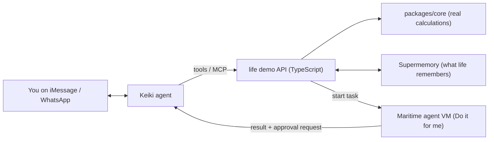

# life — Competition build: "Text life"

> A demo-sized slice of life that uses **Keiki**, **Supermemory** and **Maritime** together. Built separately from the main app (its own folder, `competition/`), on sample data, so it never slows the real build.
> Platform features below are from each product's public site and listings (16 Nov 2026); check the docs before relying on any detail.

## The pitch (one line)
**life is a life admin and wellbeing coach you just text.** No app to open: message it on iMessage or WhatsApp, it files what you say, remembers you, nudges you at the right moment, teaches you what you don't know, and does the boring admin for you, with your OK.

## Who does what

| Platform | What it does in the demo |
|---|---|
| **Keiki** | life gets its own number on iMessage and WhatsApp. The agent talks to the user, calls life's tools (TypeScript tools or our MCP server), sends scheduled check-ins (morning brief, birthday reminders, renewal nudges), and lets you step in from Keiki's inbox. |
| **Supermemory** | life's long-term memory: facts about the user ("paid on the 28th", "sister Ama, birthday 3 March", "doesn't eat pork"), filed from texts and recalled in later chats. |
| **Maritime** | Hosts **"Do it for me"**: an agent with its own sandboxed computer (one micro-VM per task) that does a real admin job, like filling a form or drafting a cancellation, and reports back in the chat for approval. |
| **life's engine** (`packages/core`) | The real numbers: tax and NI, cash plan, buffer, food targets, habit strength. The AI explains; the engine calculates. |

## The demo script (about 3 minutes)
1. **"hi, I just went freelance in London, what should I sort first?"** → life replies in two-tone plain words: register for Self Assessment by 5 October, start a tax pot of about 25%, with the figure from the engine. It **files** "freelance, London" to memory.
2. **"my sister Ama's birthday is 3 March and the dentist is Friday at 3"** → filed (Supermemory). Reply: "Got both. I'll remind you about Ama on 27 Feb so a card arrives."
3. **"what's a tax code?"** → **Teach me by text**: three short bites, one guess ("1100L instead of 1257L: more tax or less?"), then "tell it back in your own words", then "You've got it."
4. **"I pay £10.99 for Streamly and never use it"** → "Want me to cancel it?" → **yes** → a Maritime agent drafts the cancellation and the confirmation steps, then asks in the thread: "Ready to send. Approve?" Nothing is sent without that yes.
5. **Scheduled check-in (Keiki):** the next morning, "Morning. One move today: move £50 to your buffer. Ama's birthday is in 10 days." Show it arriving.
6. **Memory proof:** a new chat, "how much should I put aside from this invoice?" → it remembers you're freelance and answers with your numbers.

## Build plan (fastest path)
1. **Day 1:** `competition/api` (TypeScript): tools `file_fact`, `recall`, `todays_move`, `tax_set_aside`, `teach_me`, `do_it_for_me`. Real figures from `packages/core`; memory via the Supermemory SDK. Expose them as Keiki tools (or as an MCP server Keiki connects to).
2. **Day 1:** create the Keiki agent with life's voice and rules (plain words, two-tone replies, one question at a time, never shames, never diagnoses, guidance not advice), connect the tools, get the iMessage/WhatsApp number.
3. **Day 2:** Teach me by text (the quick-lesson format from `FENNY_LEARNING.md`, as short messages), scheduled check-ins in Keiki.
4. **Day 2:** Maritime "Do it for me": one agent that drafts a cancellation email and a checklist on a demo site, then posts back for approval. Keep the demo task safe and fake (no real accounts, no payments).
5. **Day 3:** polish the replies, record the 3-minute run, and show the board (`life-design-board-v17`) as "where this goes next".

## Rules for the demo
- **Sample data only.** No real health or bank data in third-party services during the competition.
- **Approval before any action**, every time, in the thread.
- **Copy rules still apply:** guidance not advice for money, wellness not diagnosis for health.
- Keys and secrets live in the demo API's environment, never in the chat or the repo.

## After the competition
If it lands well, "Text life" becomes a real channel in Phase 11 (life on iMessage and WhatsApp), with sensitive details kept in the app ("Open life to see your sleep") unless the user opts in. Supermemory and Maritime are re-checked then against the privacy rules in `MASTER_PLAN.md` §3.3c.
