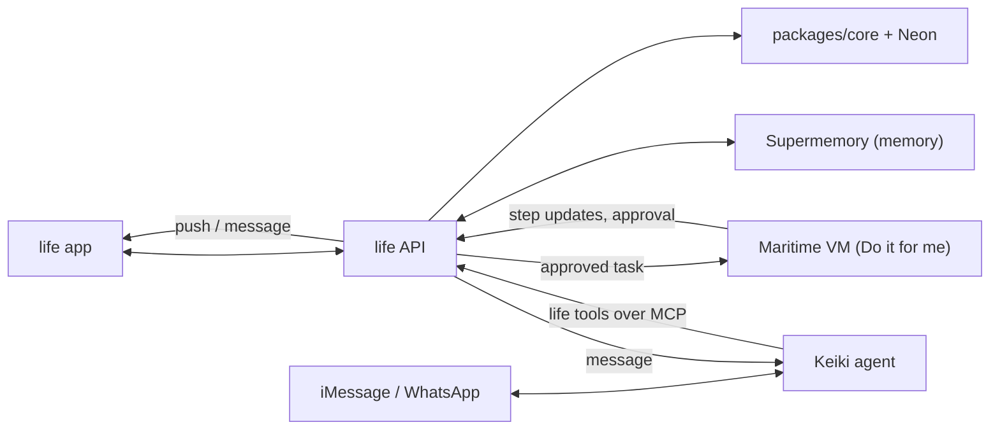

# life — Using Keiki, Supermemory and Maritime inside the app

> **The app stays the product.** These three plug into it; nothing is replaced or discarded. One account, one plan, one memory, whether you open the app or text it.
> Platform features are from each product's public site and listings (16 Nov 2026); check the docs while building.

## Where each one goes

| Platform | Its job inside life | Where in the app | Phase |
|---|---|---|---|
| **Keiki** | **Text life**: life gets its own number on iMessage and WhatsApp (also Telegram, email). Texting it is the same as talking to it in the app: it files what you say, answers with your real numbers, sends your morning brief and nudges, and can run a quick Teach me. | Talk button (a new "Text life" option), You → Settings → Text life, nudges and check-ins | 5 (Talk) |
| **Supermemory** | **What life remembers**: the long-term memory behind every conversation, in the app and by text. Facts you mention ("paid on the 28th", "sister Ama, 3 March", "doesn't eat pork") are stored and recalled. | Talk, Chat, Text life, "What life remembers" (edit and forget), Today's plan | 3 (Missions and memory) |
| **Maritime** | **Do it for me**: each approved task runs as an agent on its own sandboxed computer (fill a form, draft and send a cancellation, check a scheme), reporting each step back for approval. | "Do it for me" on missions and bills, with progress and approval in the app or by text | 11 |
| **life's own API and engine** | Still the brain: plan, numbers, records, health, food. The platforms call life's tools; they never hold the source of truth. | Everywhere | All |

## How it hangs together
- **One identity.** You link your number to your life account once (Settings → Text life). Keiki's agent calls life's API as you, through the same MCP tools we planned for "Your data in your AI".
- **One memory.** The app's Talk and Chat and Keiki's texts all write to and read from Supermemory (one memory space per user), through life's `memory.ts`. "What life remembers" in the app lists, edits and deletes those memories.
- **One plan.** Nudges and the morning brief come from `planToday()`. The app decides *what* to say; Keiki delivers it by text if you've chosen that channel, otherwise it's a notification.
- **Approval first.** "Do it for me" tasks only start after you approve, and every step that sends, pays or signs asks again, in the app or in the thread.

## Privacy rules (so the real app stays safe)
- **Text life is opt-in**, per channel. Messages keep sensitive detail light by default ("Your sleep was short; open life for details") unless you switch on "Show health and money details in texts".
- **Supermemory stores conversational facts, not raw data.** Health readings, balances and documents stay in life's own database; memory holds the useful facts ("prefers morning workouts"). Each memory shows its source and can be deleted. Check Supermemory's data-processing terms and UK GDPR fit before launch.
- **Maritime runs with no stored passwords.** The task asks you to sign in or approve where needed; nothing pays without you.
- Keys live in life's API only.

## For the competition
Show the real app plus Text life working together: start a conversation in the app, carry it on by text, have life remember it, and approve a "Do it for me" task from the thread. The board (v17) has the Text life screens; the build plan lists the work in Phases 3, 5 and 11, and this can be pulled forward as one slice for the deadline.
