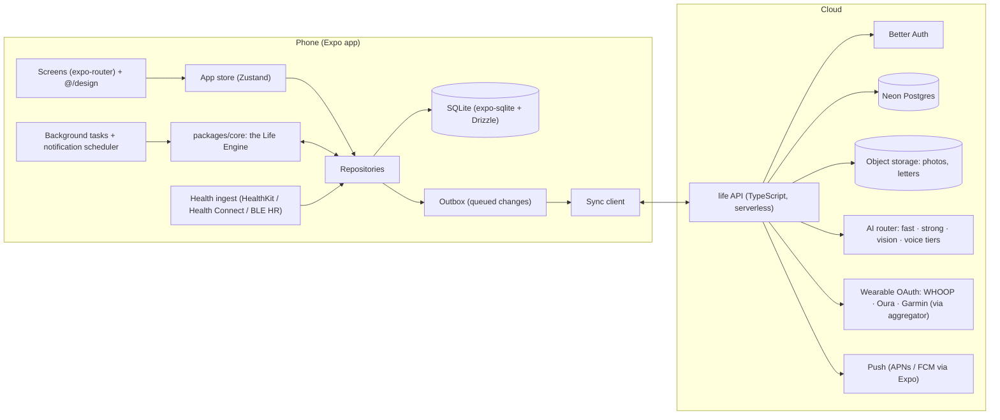
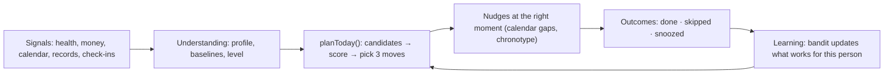

# life — System design

> **How everything connects so the app actually works**, end to end. Read with `MASTER_PLAN.md` (stack decisions), `SPEC.md` (behaviour) and `BUILD_PLAN.md` (order).
> Rule of thumb: **the phone is the source of truth; the server is for sync, AI, OAuth and anything with a secret.**

## 1. The shape

## 2. On the phone

| Layer | What it does | Built with |
|---|---|---|
| **Screens** | Every board screen, routed exactly as the board's "opens from" says (tab / push / sheet / full screen). | `expo-router`, `@/design`, `TopBar` |
| **Store** | What the screens read: profile, today's plan, missions, health summaries, prefs. Derived, never the truth. | Zustand (extend `useLifeStore`), selectors |
| **Repositories** | The only code that reads/writes the database. One per area: `profile`, `records`, `missions`, `health`, `food`, `habits`, `learning`, `people`, `documents`, `money`. Every write also appends to the outbox. | TypeScript modules |
| **Database** | The truth on the device. Encrypted at rest (SQLCipher-backed SQLite or iOS Data Protection + Android Keystore-wrapped key). | `expo-sqlite`, Drizzle ORM + migrations |
| **Engine** | Pure functions: tax, cash plan, levels, scores, targets, readiness, sleep need, load, habit strength, plan selection. No I/O, fully tested. | `packages/core` (extend `data/health.ts`, add `health/*`, `plan/*`, `food/*`) |
| **Health ingest** | Pulls samples since the last anchor, normalises to `HealthSample`, picks the best source per metric (arbitration), updates daily summaries and baselines. | `@kingstinct/react-native-healthkit`, `react-native-health-connect`, `react-native-ble-plx` |
| **Jobs** | Background fetch (health, sync), the morning plan, evening wrap, recall due, renewals, birthdays. Local notifications scheduled from the plan. | `expo-background-task`, `expo-notifications` |
| **Outbox + sync** | Every change becomes an op `{id, table, rowId, op, payload, at}`; pushed when online, pulled by cursor. | Own sync first; PowerSync only if conflicts get hard |

### The Life Engine loop (runs on the phone)

- `planToday()` is **deterministic rules + scores** from the engine, then a small **contextual bandit** (Thompson sampling) that learns which kind of move, at what time, this person actually does (MASTER_PLAN §3.4). Every pick stores its reasons, which power "Why am I seeing this?".
- The plan is recomputed: on first open each day, after a health sync, after a mission changes state, and when the user files something.

## 3. In the cloud

| Piece | Responsibility |
|---|---|
| **API** | `/sync/push`, `/sync/pull`, `/ai/*` (talk, ask, extract, food, lesson, scene, analyse, showMe, coach), `/oauth/*` callbacks, `/files/sign`, `/push/register`, `/account/export`, `/account/delete`. Validates every payload with zod. Rate-limits per user. |
| **Neon Postgres** | Mirror of the phone tables plus `users`, `devices`, `sync_ops`, `oauth_tokens` (encrypted), `lesson_cache`, `scene_cache`, `ai_usage`. Every row has `user_id`; row-level security is the second lock. A branch per build phase. |
| **Auth** | Better Auth (Apple, Google, email). Short-lived access token + refresh; the phone stores tokens in SecureStore. |
| **AI router** | Maps a job to a tier, never a fixed model. Tiers: fast (filing, extraction, tips), strong (lessons, analysis, coach, decisions), vision (meals, letters), voice (live tell-back). Picks by `tools/evals` scores. **Numbers always come from the engine;** the model only explains and drafts. Outputs are schema-checked JSON. |
| **Wearables** | WHOOP and Oura via their official OAuth APIs (webhooks where offered) → normalised samples → synced to the phone. Garmin/Polar/Suunto via an aggregator (open-wearables, self-hosted) later. **Never** read a WHOOP strap over Bluetooth. |
| **Files** | Meal photos and scanned letters: uploaded with a signed URL, read by the vision tier, deleted after reading unless the user keeps them. |
| **Push** | Expo push tokens per device; server sends only for things the phone can't know (a WHOOP sync, a reply ready). Everything else is a local notification. |

## 4. The data model (core tables)

All tables: `id (uuid)`, `user_id`, `created_at`, `updated_at`, `deleted_at` (soft delete for sync).

| Table | Key fields |
|---|---|
| `profile` | name, date_of_birth, where (postcode area), work, household, pay_day, chronotype, values[], big_five{}, level, chapter |
| `body_profile` | height_cm, weight_kg (trend), waist_cm, body_fat_pct, sex_at_birth, activity_level, ethnicity_for_ranges (optional, used only for NHS BMI thresholds), units |
| `health_sample` | type, start, end, value, unit, source, device, confidence |
| `daily_health` | date, sleep{asleep, stages, need, debt, regularity}, readiness{score, drivers}, load{score, zones, target}, signals{skin_temp, rhr, resp, hrv}, steps, water_ml |
| `baseline` | metric, window_days, mean, sd, updated_at |
| `food_entry` | at, items[{name, db_id, grams, kcal, protein, carbs, fat, fibre, confidence}], photo_ref, confirmed, fit_score |
| `food_target` | goal, target_weight, pace, kcal, protein, carbs, fat, fibre, exercise_addback |
| `saved_meal` | name, items[], default_portion |
| `habit` + `habit_log` | name, cue, schedule, strength (EMA); log: date, done, source |
| `record` (FiledRecord) | kind (bill, date, fact, person, insight, document…), fields{}, source (talk/chat/scan), confidence |
| `mission` + `mission_step` | title, area, stage, value, due; steps with state and drafts |
| `person` + `important_date` | name, relation, contact_ref; date kind (birthday, anniversary, memorial), reminder |
| `document` | kind (passport, MOT, insurance…), expires, act_from, file_ref |
| `learning_record` | topic, source (library/teachme), level, guess, puzzles[], teach_back{covered, missing}, fsrs{due, stability, difficulty}, led_to |
| `plan_day` + `nudge` | date, moves[{kind, ref, reasons[]}]; nudge: at, kind, outcome |
| `bandit_arm` | context_key, arm, alpha, beta |
| `memory` | text, source, last_used, user_editable |
| `prefs` | look, sounds, haptics, hand_drawn, hide_numbers, notifications{}, private_mode |

## 5. The key flows

**Onboarding:** welcome → questions → where you live → **body numbers** → devices → notifications → Aim → building your plan (engine runs locally) → first move → (optional) sign in, which starts sync.

**Health:** background task → ingest since anchor → arbitration picks a source per metric → daily summaries → baselines (rolling 28/60 days) → scores in `packages/core/health` (readiness, sleep need/debt, load + target band, zones, illness signal, regularity) → plan recompute → nudges.

**Food:** snap/scan/say/search → (vision tier or barcode lookup) → items with confidence → user confirms → `food_entry` → targets from `food_target` + body profile + activity → Fuel counters update → fit score + tips.

**Talk / chat:** voice → on-device speech-to-text → `/ai/extract` (fast tier) → proposed records shown in the filing tray → user confirms → repositories write → plan recompute. While waiting, the orb is `thinking`; while checking schemes, `searching`.

**Teach me:** a term without a `learning_record` shows the button → `/ai/lesson` (strong tier, cached per topic + level) returns bites with scene JSON → the drawing kit renders scenes → puzzles → tell it back (`/ai/analyse`) → `learning_record` + FSRS schedule → back to the action.

**Missions:** engine finds an eligible task → mission with steps → drafts via `/ai/draft` → "Do it for me" only with explicit approval, step by step → outcome filed.

## 6. Cross-cutting

- **Privacy:** health is special-category data. Minimum data to the server; private mode keeps AI on the phone; export and delete everything from Settings; no ads, no training without opt-in.
- **Offline:** everything except AI and wearable OAuth works offline; AI requests queue with a clear "will answer when back" state.
- **Observability:** Sentry (crashes), privacy-preserving product analytics (moves done per week), API logs without personal content, AI cost per job.
- **Testing:** engine unit tests (scores, tax, targets), repository tests on an in-memory SQLite, API contract tests, Maestro end-to-end flows (onboarding, Talk → file, snap a meal, a lesson), eval sets per AI job.
- **Releases:** EAS builds per platform; OTA updates for JS-only changes; feature flags for risky features (private mode, Do it for me, CGM).

## 7. Build order for the system (mapped to BUILD_PLAN)
1. Phase 1: store shape, routes, `TopBar`, `LifeOrb` v6, design tokens (no borders, card shadows).
2. Phase 1b: SQLite + Drizzle schema above, repositories, outbox, sync client; API skeleton with auth, sync and AI router stubs; Neon branch.
3. Phases 2–4d: engine functions per area wired through repositories; health ingest + background tasks.
4. Phases 5–8b: AI jobs behind the router, the drawing kit, lessons.
5. Phases 9–13: levels, polish, beta, launch.
